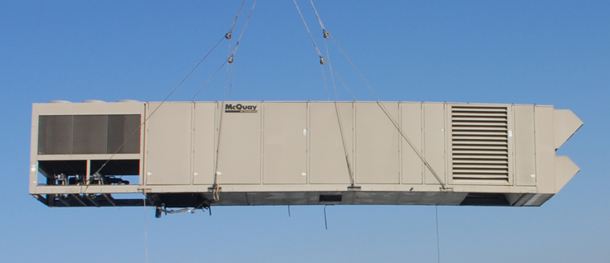
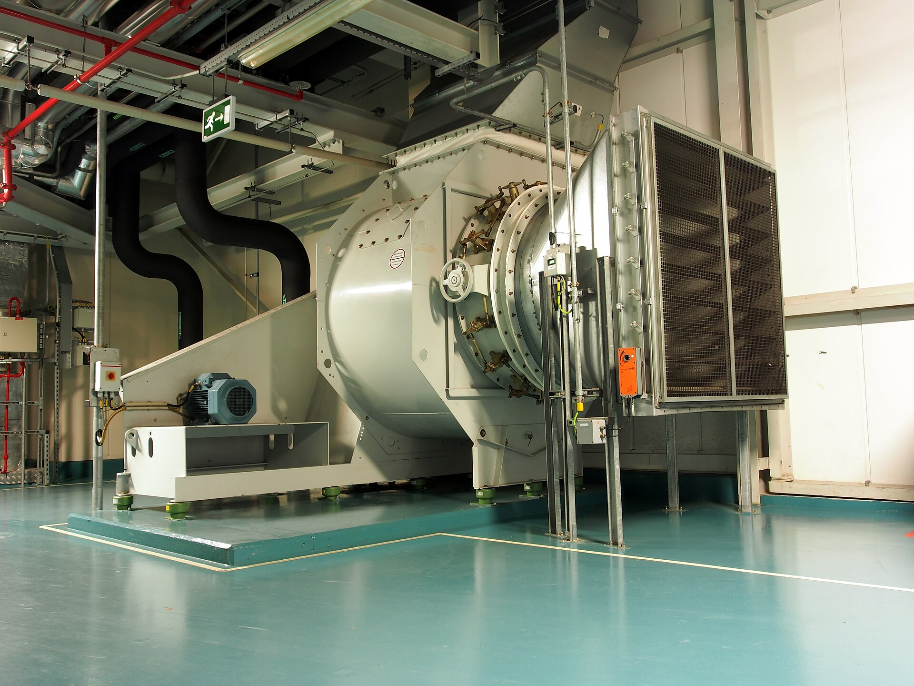
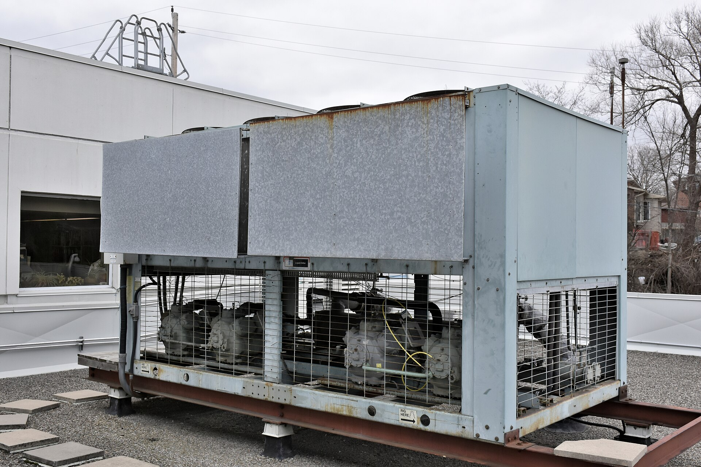
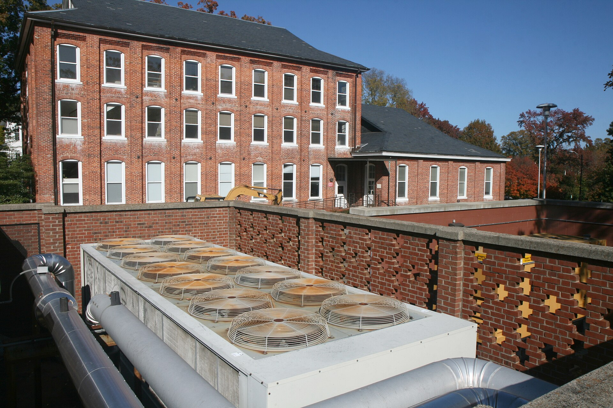
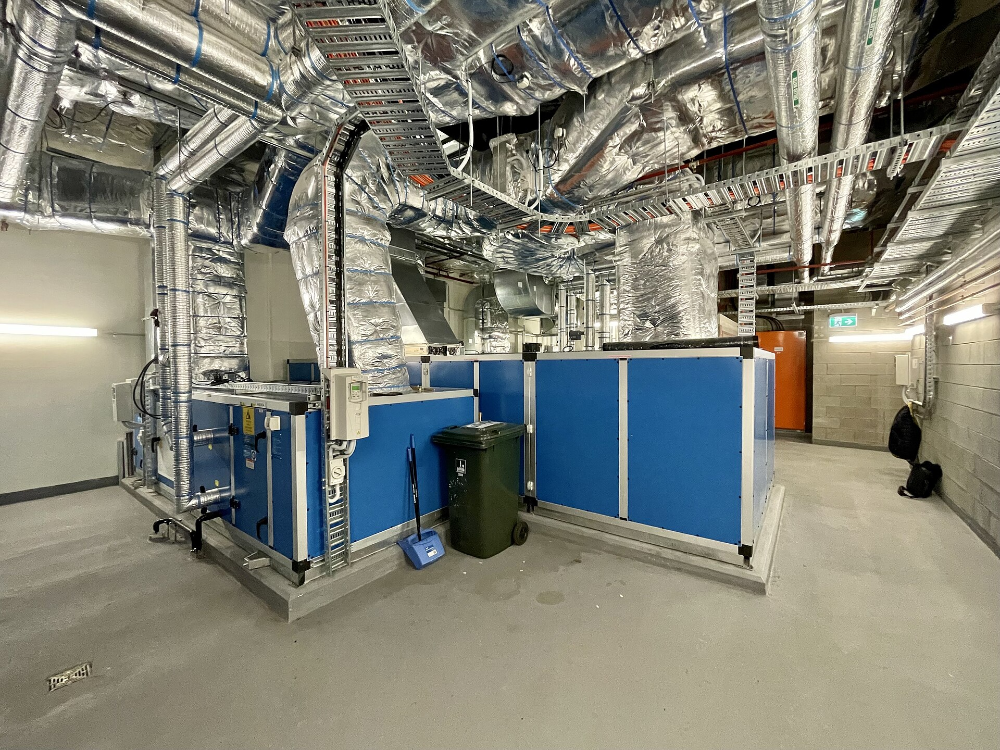
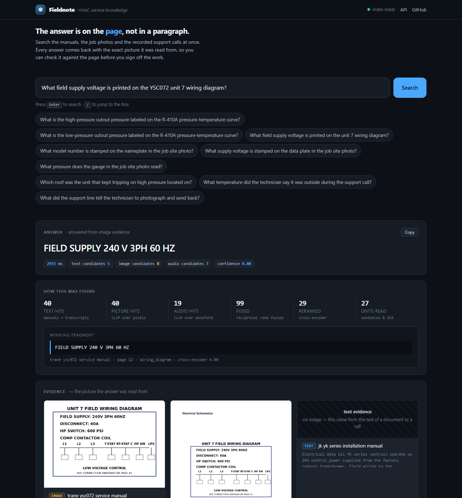
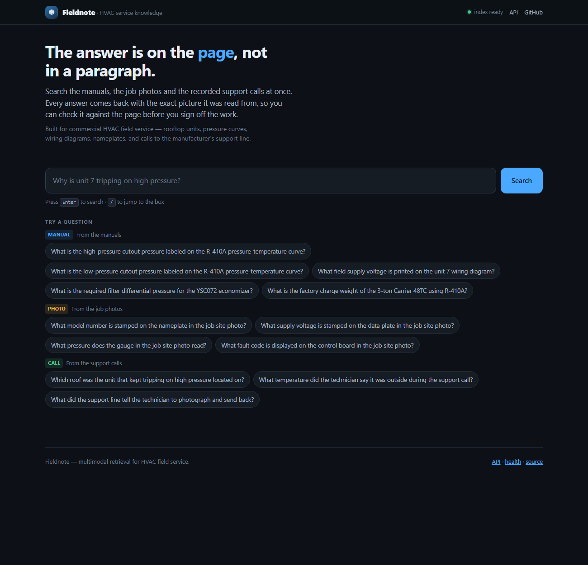

# Fieldnote

**Search the manuals, the job photos and the recorded support calls at once — and
get the answer back with the picture it was read from.**

[](docs/images/rooftop-hvac.jpg)
<sub>Rooftop HVAC unit being craned into position. Photo: Los Angeles Air Force Base, public domain, via Wikimedia Commons.</sub>

---

## Contents

1. [What HVAC is, and what the work actually looks like](#1-what-hvac-is-and-what-the-work-actually-looks-like)
2. [The problem: the answer is a picture](#2-the-problem-the-answer-is-a-picture)
3. [What Fieldnote does](#3-what-fieldnote-does)
4. [The results](#4-the-results)
5. [How it works, step by step](#5-how-it-works-step-by-step)
6. [Reading the screen](#6-reading-the-screen)
7. [Run it](#7-run-it)
8. [Deploy it with Docker](#8-deploy-it-with-docker)
9. [How to explain this to someone else](#9-how-to-explain-this-to-someone-else)
10. [Honest limitations](#10-honest-limitations)
11. [Design notes, layout, tests](#11-design-notes-layout-tests)

---

## 1. What HVAC is, and what the work actually looks like

**HVAC** stands for **Heating, Ventilation and Air Conditioning**. It is the
trade that keeps buildings at a temperature people can work in, moves the air
around them, and removes the humidity from it. Almost every commercial
building you walk into runs on it, usually from equipment you never see.

The equipment splits into two halves, and this matters for the rest of the
story:

| | what it is | where you find it |
|---|---|---|
| **Air handling** | moves and conditions the air — filters, coils, blowers, dampers | a plant room, a mechanical room, the ceiling of an office |
| **Refrigeration** | moves heat from inside to outside — compressors, condensers, expansion valves, refrigerant | on the roof, or in a plant room |

<p align="center">
  
  
  
</p>
<sub>Left: an air handling unit. Centre: an air-cooled chiller. Right: outdoor condensing units on a rooftop. All via Wikimedia Commons — see <a href="docs/images/CREDITS.md">credits</a>.</sub>

**The work** is done by field technicians, and it is harder than it looks. A
commercial HVAC contractor might run 40 technicians, each of them driving to
a different building every day, and none of them can memorise the service
manual for every make of rooftop unit that their customers own. A single
technician's week is a sequence of:

- reading a fault on a control board and deciding what it means;
- finding the right procedure in a 300-page manual for a unit they have never
  seen before;
- reading a pressure-temperature curve to work out what a gauge reading
  *should* be at today's outdoor temperature;
- matching a wiring diagram to a field-wired panel with somebody else's
  workmanship in it;
- recognising a failed part from a photograph — a bulged capacitor, a pitted
  contactor, a corroded coil;
- calling the manufacturer's support line, being put on hold, and being asked
  questions they answered on the first call.

Every one of those steps is a **knowledge lookup**, and almost all of them
turn into "open the right document, find the right page, read the right number".

<p align="center">
  
</p>
<sub>Rooftop units on a large commercial building. Photo: Kgbo, CC BY-SA 4.0, via Wikimedia Commons.</sub>

---

## 2. The problem: the answer is a picture

Here is a real question from that world:

> **"Why does unit 7 keep tripping on high pressure?"**

Where is the answer? Not in a paragraph. It is in three places at once:

| where | what is there | what it looks like |
|---|---|---|
| the service manual, page 112 | the high-pressure cutout setting for that refrigerant | a **labelled point on a graph** — "HP CUTOUT 385 PSI" |
| the job-site photo | the actual model of the unit on that roof, which is not the model on the paperwork | a **stamped nameplate** |
| the recorded support call | which roof the unit is on, and what the technician was told to check | **two sentences of speech** |

This is the shape of almost every field-service question. The knowledge is
spread across three media, and the part that matters most — the number — lives
in a **picture**.

### Why the usual approach fails

The standard way to make a picture searchable is to describe it and search the
description:

```
image  ──►  "a line graph with a blue line and a red line"  ──►  text embedding
```

This works right up until the question needs a number. A caption of a
pressure-temperature curve says *"a graph with a line going up"*. The question
needs **385**. The caption does not contain 385 — and because the captioning
happened when the document was **indexed**, nothing that happens afterwards can
put it back. The number was destroyed before anyone asked a question.

That is the trap this project exists to avoid. It is a text pipeline wearing a
costume.

---

## 3. What Fieldnote does

Fieldnote keeps pictures **as pictures**. It gives each kind of evidence its
own searcher, searches all of them at once, and then reads the answer out of
the evidence that actually contains it — handing back the picture so the
technician can check it.



Four things happen when you ask a question:

1. **Three searchers run in parallel** — one that reads text, one that looks at
   pixels, one that listens to waveforms. A typed question reaches all three,
   because each model's text tower shares a vector space with its own image
   and audio tower.
2. **The result lists are merged** with Reciprocal Rank Fusion, which only
   looks at *ranks*, so it does not care that the three searchers score on
   different scales.
3. **A cross-encoder judges the shortlist** and then judges the individual
   fragments inside the winners — because the sentence that says "15 minutes"
   is the answer, and the 900-character paragraph it came from is not.
4. **The answer is read out of the pixels**, using OCR plus the layout of the
   page, and it comes back with the page number, the cropped region and the
   full page to check it against.

---

## 4. The results

40 questions. 15 of them are **provably** unanswerable from text — the eval
checks the prose, the captions and the transcripts at run time and fails if a
picture-only answer turns up in any of them. CPU only, 8 cores, no GPU.

| metric | fieldnote | caption-only baseline | delta |
|---|---|---|---|
| accuracy, all 40 questions | **100.0%** | 60.0% | +40.0 pts |
| **accuracy, 15 picture-only questions** | **100.0%** | **0.0%** | **+100.0 pts** |
| accuracy, 25 text-answerable questions | **100.0%** | 96.0% | +4.0 pts |

| latency (ms, end to end) | p50 | p95 | p99 | max |
|---|---|---|---|---|
| fieldnote | 2386 | **2911** | 2951 | 2951 |
| caption-only baseline | 1703 | 2868 | 3139 | 3139 |

| citation compliance | fieldnote | caption-only baseline |
|---|---|---|
| answers carrying a cropped image | **40 / 40** | 0 / 40 |
| answers carrying a page number | 36 / 40 | 40 / 40 |
| citation points at the right page | 90.0% | 87.5% |

| source modality of the winning evidence | fieldnote | caption-only baseline |
|---|---|---|
| image | **11** | 2 |
| audio | 5 | 6 |
| text | 24 | 32 |

The four answers without a page number are the job-site photos, which have no
page to cite. Everything else points at a page and a rectangle.

**The baseline is not a strawman.** It is the same system with the same
reranker, grader, synthesis and latency budget — the only difference is that
every image is captioned and embedded as text. Notice that the baseline still
*retrieves* the right chart: it finds the figure, and then cannot read the
number off it. Retrieval was never the problem. The lossy step in the middle
was.

Full report: [`data/artifacts/eval_report.md`](data/artifacts/eval_report.md) —
regenerate with `fieldnote eval`.

---

## 5. How it works, step by step

### 5.1 The corpus

The knowledge a contractor has looks like this:

- **300 service manuals** (PDF). Prose, wiring diagrams, pressure-temperature
  curves, performance charts, spec tables, torque specs.
- **4,000 job-site photos**. Nameplates, gauges, control boards, failed parts.
- **Recorded calls** to the manufacturer's support line.

The project ships a synthetic version of all three, generated from a single
spec file that produces **both the corpus and the eval set** — so a question
can never point at evidence that is not there.

```bash
fieldnote build     # render the corpus
fieldnote ingest    # manuals -> pages, crops, OCR, transcripts
```

`ingest` is where the multimodal work starts:

- **PDFs** are opened with PyMuPDF. Each page is rendered at 200 dpi, and the
  **figure regions are cut out of it** — PyMuPDF's drawing clusters, image
  rectangles and table detection give the geometry, and the regions are
  classified as chart, wiring diagram, table, figure or photo. Each region
  becomes its own image chunk, and the page's prose becomes text chunks.
- **Photos** become image chunks, OCR'd for nameplates, gauge readings and
  fault codes.
- **Calls** are transcribed by Whisper into timestamped segments, so a chunk
  can point at the exact second of the call it came from.

### 5.2 Three encoders, three spaces

| modality | encoder | space | what it is good at |
|---|---|---|---|
| text | MiniLM | 384-d | prose, transcripts, OCR strings |
| image | CLIP image tower | 512-d | pixels, charts, nameplates |
| audio | CLAP audio tower | 512-d | waveforms, acoustics |

Nothing is routed through a caption. **Images get no text projection at all** —
that is the whole point.

The subtlety that makes it work: CLIP's *text* tower and its *image* tower
share a space, so a typed question can reach the picture index. Same for CLAP
and audio. Without that, the question never gets to two thirds of the index.

**Audio is indexed twice, on purpose** — the waveform in the audio space, and
the transcript in the text space. A transcript is language, not a lossy summary
of a picture. Flattening a call to a caption would be as silly as flattening a
chart; flattening a chart is the bug.

### 5.3 Retrieval: parallel search, then fusion, then rerank

```
                 question (text)
                        │
        ┌───────────────┼───────────────┐
   MiniLM(text)   CLIP text tower   CLAP text tower
        │               │               │
   text space       image space      audio space
 (prose + tx)       (pixels)         (waveform)
        │               │               │
        └────── parallel search ─────────┘
                        │
             Reciprocal Rank Fusion
                        │
         cross-encoder rerank (shortlist)
                        │
        expand the best chunks into units
      (sentences · OCR phrases · call lines)
                        │
          cross-encoder rerank (units)
                        │
                answer  +  citations
```

**Why Reciprocal Rank Fusion and not a score sum?** The three spaces produce
scores on incomparable scales — a CLIP cosine of 0.28 and a MiniLM cosine of
0.62 mean nothing relative to each other, and normalising them by hand is
fragile and unfalsifiable. RRF only uses ranks, so it is scale-free by
construction and has one parameter that is not fitted to the eval set.

**Why rerank twice?** A cross-encoder judges a question and a passage
*together*, which is why it beats a bi-encoder — but it cannot be
precomputed, so every pair it judges is paid for on every question. Judging
30 pairs takes about a second; judging 150 takes five and buys nothing. So
the first pass picks the right *documents*, and the second pass picks the
right *fragment inside them*.

**Why expand into units?** Because the answer to "how long must the unit run
before the subcooling is checked?" is the sentence that says *15 minutes*, not
the 900-character block it came from.

### 5.4 Reading the number off a chart

The picture-only questions are answered by OCR and geometry, not by a vision
model:

1. **The region is cut out** of the rendered page.
2. **OCR reads it** — and OCR does not know where words end, so it hands back
   `LPCUTOUT92PSI`. A **de-mangler** repairs that against an HVAC vocabulary,
   producing `LP CUTOUT 92 PSI`. It only accepts a segmentation that accounts
   for the *whole* token; anything it cannot fully explain is left alone,
   because a wrong split corrupts the evidence.
3. **The OCR boxes carry geometry.** A table cell is paired with its column
   header and its row label, so `2400 CFM` is known to be "maximum indoor
   airflow" for the 6-ton unit because of *where it sits*, not because of
   what it says.
4. **The question is split** into the thing being asked for and the place to
   look. "What field supply voltage is printed **on the YSC072 unit 7 wiring
   diagram**?" is two questions; only the first may decide the answer.
5. **A caption is refused.** A figure caption describes a figure; it does not
   state what the figure says, so it can never be the answer to a question
   about a value. Neither can a bare axis label like "300".

### 5.5 The answer and its citations

The answer is a fragment plus its provenance:

```
385 (385 PSI)
  page 11 · chart · trane ysc072 service manual · crop attached
```

`40 / 40` answers carry a cropped image, and the `/page/{chunk_id}` endpoint
returns the **whole page with the cited region outlined** — the view that
settles a disagreement with a customer.

---

## 6. Reading the screen

<p align="center">
  
</p>

- **The box at the top** is the whole interface. Type a question, press
  <kbd>Enter</kbd>. Press <kbd>/</kbd> from anywhere to jump back to it.
- **The example questions** are grouped by where the answer lives — manual,
  photo, call. Click one to run it.
- **Answer** is the fragment, with a **Copy** button. Underneath: how long it
  took, how many candidates each searcher contributed, and a confidence score.
- **How this was found** is the retrieval trace: 40 text hits, 40 picture
  hits, 19 audio hits → 99 fused → 29 reranked → 27 fragments read. Below it,
  the **winning fragment** verbatim, with its page, region and cross-encoder
  score. This is the part that answers "why did it say that?".
- **Evidence** is the picture, the region, and the score for each candidate.
  Click any image to enlarge it; **full page** opens the page with the region
  outlined; **raw** opens the underlying chunk, including its OCR text.
- A question in the URL runs itself, so an answer can be shared as a link.

---

## 7. Run it

```bash
git clone https://github.com/Gunjannnn30/fieldnote.git
cd fieldnote
pip install -e ".[dev]"

fieldnote models        # pre-download the six models (~2 GB)
fieldnote build         # render the synthetic corpus
fieldnote ingest        # manuals -> pages, crops, OCR, transcripts
fieldnote index         # encode into the vector store
fieldnote serve         # http://127.0.0.1:8000/
```

`build`, `ingest` and `index` are one-time setup. After that it is just
`fieldnote serve`.

| command | what it does |
|---|---|
| `fieldnote build` | render the synthetic corpus (manuals, photos, calls) |
| `fieldnote ingest` | turn the corpus into a chunk manifest |
| `fieldnote index` | encode the manifest into the vector store |
| `fieldnote ask "..."` | one question, with citations, in the terminal |
| `fieldnote serve` | the API and the browser UI |
| `fieldnote serve --tunnel` | the same, plus a public https URL |
| `fieldnote eval` | run the evaluation, write the report |
| `fieldnote verify` | check the fixtures are honest |
| `fieldnote models` | pre-download every model |

### The API

```bash
curl -X POST http://127.0.0.1:8000/ask \
  -H "Content-Type: application/json" \
  -d '{"question":"What model number is stamped on the nameplate in the job site photo?","include_crops":true}'
```

```json
{
  "answer": "MODEL NP-42",
  "latency_ms": 2732.4,
  "citations": [{
    "modality": "image",
    "doc_title": "Job Photo - Unit 7 Nameplate",
    "page": null,
    "region": "job_photo",
    "crop_b64": "data:image/png;base64,iVBORw0KGgo..."
  }],
  "trace": { "spaces": {"text": 40, "image": 40, "audio": 19}, "fused": 99, "units": 27 }
}
```

| endpoint | what it does |
|---|---|
| `POST /ask` | ask a question; returns the answer, the citations and the trace |
| `GET /` | the browser UI |
| `GET /health` | liveness and index state |
| `GET /page/{chunk_id}` | the full page with the cited region outlined |
| `GET /evidence/{chunk_id}` | the raw chunk behind a citation |
| `GET /docs` | interactive OpenAPI documentation |

---

## 8. Deploy it with Docker

```bash
docker compose up -d --build
```

That is the whole thing. The image is CPU-only (no CUDA, ~2 GB smaller), ships
the models so the first request is not a two-gigabyte download, runs as a
non-root user, and builds the corpus and the index on first start into a named
volume. There is a healthcheck, so `docker compose ps` tells you when it is
ready.

To publish it:

```bash
./scripts/docker_up.sh        # macOS / Linux
./scripts/docker_up.ps1       # Windows
```

Both build the image, start the service, wait for it to become healthy, then
open a public https tunnel and print the URL.

### Point it at your own data

Nothing in the system assumes the synthetic corpus. `ingest` walks a directory
and dispatches by file type — `.pdf` for manuals, images for job photos,
`.wav` / `.mp3` / `.m4a` for calls:

```bash
export FIELDNOTE_CORPUS_DIR=/srv/hvac-corpus
fieldnote ingest
fieldnote index
```

---

## 9. How to explain this to someone else

**Ten seconds**

> It's a search engine for HVAC technicians. The answer is usually a number
> printed on a graph. Most AI tools throw those numbers away by describing the
> picture instead of reading it. This one keeps the picture as a picture, so it
> can tell you the number — and shows you the picture so you can check it.

**Thirty seconds**

> A tech on a roof types one question. Fieldnote searches the manuals, the job
> photos and the recorded support calls at the same time, with a different
> searcher for each — one that reads text, one that looks at pictures, one that
> listens to sound. It then ranks what each one found and picks the best
> evidence.
>
> The important part: the picture searcher works on the actual pixels. A
> pressure-temperature curve is never turned into a description like "a line
> going up", because that description does not contain the 385 the technician
> needs. Fieldnote reads the number off the graph and hands back the answer
> with a crop of the exact spot, so the tech can verify it against the manual.

**Two minutes**

> **The problem.** A commercial HVAC contractor runs 40 field technicians
> across 300 manuals with wiring diagrams and pressure curves, 4,000 photos of
> failed parts, and recorded calls to the manufacturer's support line. A tech
> asking "why does unit 7 keep tripping on high pressure" needs a number from
> a chart on page 112, a model number off a nameplate, and a location from a
> phone call.
>
> **The trap.** The standard approach to "multimodal" search is to caption
> every image with a vision model and embed the caption as text. It works right
> up until the question needs a number. A caption of a pressure curve says "a
> graph with a line going up" — it has no 385 in it, and because the captioning
> happened at *indexing* time, nothing downstream can get it back. That is a
> text pipeline wearing a costume.
>
> **The approach.** Fieldnote indexes each modality in the space where its
> signal is strongest — pixels for images, waveforms for audio, tokens for
> prose — and fuses the three result lists with Reciprocal Rank Fusion before
> a cross-encoder makes the final call. The picture is still pixels at the
> moment the question is asked, so the numbers are still there.
>
> **The evidence.** On a 40-question eval where 15 questions are *provably*
> unanswerable from text, Fieldnote scores 100% against the caption-only
> baseline's 0%. The baseline is implemented properly — same reranker, same
> grader, same synthesis — so the only difference is whether the images were
> flattened. Notably the baseline still *retrieves* the right chart; it just
> cannot read the number off it. Retrieval was never the problem. The lossy
> step in the middle was.
>
> **The honest caveat.** The corpus is synthetic, because the real manuals are
> not in this repository. The system is real; the numbers are measured on a
> corpus we generated. A real corpus of 300 scanned manuals will be harder.

---

## 10. Honest limitations

- **The corpus is synthetic.** There are no real HVAC manuals in this
  repository. The system is real, but the numbers above are measured on a
  corpus we generated, and 300 scanned manuals will be harder — noisier OCR,
  worse figure detection, more languages.
- **Latency is measured on 8 CPU cores** with the deterministic synthesiser.
  The p95 of 2.9 s is under the 6 s budget. The VLM synthesiser path
  (`FIELDNOTE_SYNTHESIS=vlm`) is far slower and is not what the gate is
  measured against.
- **The answer is extractive by default**: it picks the best-supported
  fragment and states it, rather than writing prose. That is deliberate for a
  field tool — a number that can be traced beats a paragraph that reads well —
  and it is what makes the citations meaningful.
- **The charts it reads best are charts with labels.** A value printed *on* a
  curve is read exactly. A value at an arbitrary point on an unmarked curve
  needs a model that can interpolate, and the answer should be marked as an
  estimate when it is one.
- **Audio was never the hard modality.** The baseline gets the audio questions
  nearly right too, because a transcript *is* text. The interesting result is
  the one about images, and the eval is shaped to make that visible.
- **The Docker path needs a host that can run Linux containers.** On this
  machine Docker Desktop is installed and the WSL2 features are enabled, but
  the host is itself a guest without nested virtualization, so the Linux
  engine cannot start here. The compose file and image are complete and the
  `docker compose config` check passes; on a normal machine or VPS,
  `docker compose up -d --build` is the whole deployment.

---

## 11. Design notes, layout, tests

**[docs/DESIGN.md](docs/DESIGN.md)** covers early fusion versus late fusion in
full, why converting a chart to a caption throws away the axis values the
question actually needed, the module map, the scoring model and its weights,
and the seven bugs that cost the most time — including a chunk-id collision
that silently turned every picture into its own caption, and a 28-second
latency that was really 150 cross-encoder calls and 63 re-encodings per
question.

```
fieldnote/
  schema.py            Chunk, Modality, Citation, Trace - the modality tag lives here
  config.py            every tunable, every model id
  textutil.py          normalisation, sentence splitting, domain synonyms
  encode/              text (MiniLM), image (CLIP), audio (CLAP) encoders
  ingest/              pdf, images, audio -> chunks
  vision/              region detection, OCR, OCR de-mangling
  store/               sqlite | pgvector | qdrant, one space per modality
  retrieve/            parallel search, RRF fusion, cross-encoder reranking
  answer/              evidence units, synthesis, citations, VLM engine
  baseline/            the caption-only system, implemented properly
  eval/                dataset, grader, runner, report
  fixtures/            the synthetic corpus and its self-checks
  serve/               FastAPI app and the browser UI
  cli.py               fieldnote build | ingest | index | ask | eval | serve
Dockerfile             CPU-only image, models baked in, non-root
docker-compose.yml     one command to a running service
docs/images/           README photography and UI screenshots
```

```bash
pytest                 # fast unit tests
pytest -m slow         # integration tests (needs the models and the corpus)
ruff check .           # lint
fieldnote eval         # regenerate the report
```

## Licence

MIT. The photographs in `docs/images/` are used under the licences recorded in
[`docs/images/CREDITS.md`](docs/images/CREDITS.md).
